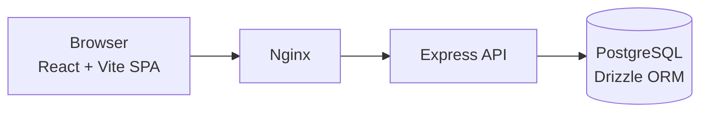

# Mental Health Assessment SaaS (Genesis for Health) — Case Study

> Multi-tenant SaaS I designed and built for **Genesis for Health** to run mental health assessments.
> **Source code is private.** This repository documents the project; a live walkthrough is available on request.

## What it does

- **Multi-tenant** platform: each organization manages its own users, patients and assessments with isolated data.
- Applies and scores **mental health assessments** and keeps the history for follow-up.
- Built with sensitive health data in mind: access control per tenant and per role.

## Architecture

- React + Vite front end, Express API, Drizzle ORM on PostgreSQL.
- **Self-hosted** on a VPS behind Nginx (TLS, reverse proxy), keeping infrastructure cost low.

## My role

Architecture, data modeling, full stack development, deployment and infrastructure.

---
Built by **Victor Sestrem** · [LinkedIn](https://www.linkedin.com/in/victor-sestrem/) · victor-sestrem@hotmail.com
